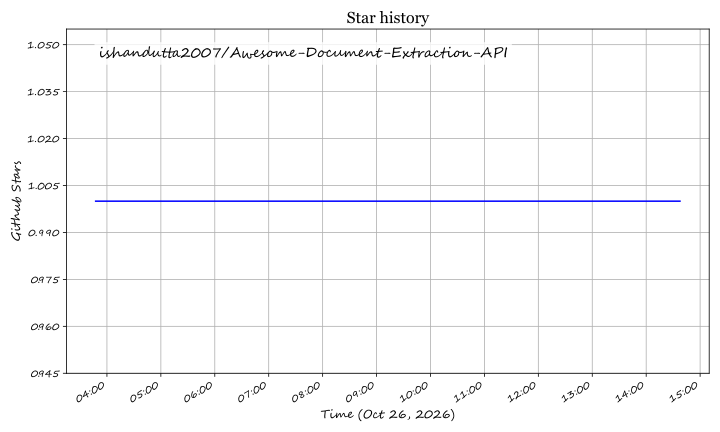

<p align="center">
  
</p>

<p align="center">
  <a href="https://github.com/ishandutta2007/Awesome-Awesome-Awesome"></a>
  <a href="https://discord.gg/jc4xtF58Ve"></a>
  <a href="https://github.com/ishandutta2007/Awesome-Document-Extraction-API/stargazers"></a>
  <a href="https://github.com/ishandutta2007/Awesome-Document-Extraction-API/network/members"></a>
  <a href="https://github.com/ishandutta2007/Awesome-Document-Extraction-API/blob/main/LICENSE"></a>
  <a href="https://github.com/ishandutta2007/Awesome-Document-Extraction-API/issues"></a>
  <a href="https://github.com/ishandutta2007"></a>
</p>

---

# 📑 Awesome Document Extraction API & Intelligent Document Processing (IDP)

> **A comprehensive, SEO-optimized directory of enterprise SaaS Document Extraction APIs and open-source Document AI parsers.** Extract structured JSON, Markdown, key-value pairs, tables, and bounding boxes from PDFs, scanned documents, receipts, invoices, IDs, and financial statements.

---

## 📌 Table of Contents

- [🌐 Sector Overview & Market Dynamics](#-sector-overview--market-dynamics)
- [🏢 SaaS & Hosted Commercial Platforms](#-saas--hosted-commercial-platforms)
- [💻 Open-Source Document AI & OCR Projects](#-open-source-document-ai--ocr-projects)
  - [⭐ Open-Source Leaderboard & Stars_Counts](#-open-source-leaderboard--star-counts)
  - [🔍 Detailed Project Overviews](#-detailed-project-overviews)
- [🛠️ Architecture: Custom Self-Hosted Pipeline](#️-architecture-custom-self-hosted-pipeline)
- [🤝 How to Contribute](#-how-to-contribute)
- [💖 Support & Community](#-support--community)
- [📈 Star History](#--star-history)
- [⚖️ Disclaimer & Compliance](#️-disclaimer--compliance)

---

## 🌐 Sector Overview & Market Dynamics

The global **Intelligent Document Processing (IDP)** and **Document Extraction API** market is valued at approximately **$2.58 billion in 2024** and is projected to expand rapidly beyond **$12.5 to $15.2 billion by 2030**, reflecting a compound annual growth rate (**CAGR**) of **30.5% – 32.8%**. This explosive acceleration is catalyzed by the convergence of Vision-Language Models (VLMs), Retrieval-Augmented Generation (RAG) pipelines, and autonomous agent workflows requiring clean, structured inputs from legacy enterprise documents.

In terms of competitive landscape, the sector remains **moderately to highly fragmented** rather than a winner-take-all monopoly:
- **Cloud Hyperscalers** (*Microsoft, Alphabet, Amazon*) dominate high-volume baseline OCR, raw text extraction, and standardized layout detection with ultra-low per-page pricing.
- **Specialized Enterprise IDP Providers** (*ABBYY, Tungsten/Kofax, Rossum, Hyperscience*) command high customer retention and pricing power in mission-critical vertical workflows (such as accounts payable, trade finance, medical claims, and Know Your Customer / AML compliance) where human-in-the-loop review and deterministic business rules are paramount.
- **Next-Gen Open-Source & VLM Frameworks** (*Docling, MinerU, Marker, PaddleOCR*) are rapidly disrupting proprietary pricing models by enabling enterprise data sovereignty, offline zero-data-leakage compliance (HIPAA/GDPR), and bespoke fine-tuning.

---

## 🏢 SaaS & Hosted Commercial Platforms

Below is a curated comparison of leading commercial SaaS Document Extraction APIs. The table is sorted **descending by Company Size (Valuation / Annual Revenue)**.

| 🏢 Platform & Provider | 📊 Company Size (Valuation / Revenue) | 💵 Starting Pricing (Specific) | 🎁 Free Tier / Free Trial Limits | ⚡ Core Capabilities & Key Extractors |
| :--- | :--- | :--- | :--- | :--- |
| **[Azure AI Document Intelligence](https://azure.microsoft.com/en-us/products/ai-services/ai-document-intelligence)** <br>*(Microsoft)* | **~$3.1T** Market Cap <br>*(~$245B+ Annual Revenue)* | • **$1.50** / 1,000 pages (Read API)<br>• **$10.00** / 1,000 pages (Prebuilt Layout & Invoices)<br>• **$50.00** / 1,000 pages (Custom Neural Models) | **Free F0 Tier:** 500 pages/month forever (20 pages/min limit) + $200 Azure cloud credits for 30 days | Prebuilt extractors for W-2, invoices, receipts, tax forms, IDs, tabular extraction with bounding boxes, REST API & enterprise SDKs |
| **[Google Cloud Document AI](https://cloud.google.com/document-ai)** <br>*(Alphabet)* | **~$2.1T** Market Cap <br>*(~$350B+ Annual Revenue)* | • **$1.50** / 1,000 pages (Document OCR)<br>• **$10.00** / 1,000 pages (Form Parser)<br>• **$30.00** / 1,000 pages (Specialized Invoices/IDs/Procurement) | **Free Tier:** 1,000 pages/month free forever for Document OCR; $300 new customer credit valid across GCP for 90 days | Pre-trained and custom extractors, layout analysis, Generative AI field synthesis for inferred values, human-in-the-loop review workbench |
| **[AWS Textract](https://aws.amazon.com/textract/)** <br>*(Amazon Web Services)* | **~$1.9T** Market Cap <br>*(~$600B+ Annual Revenue)* | • **$1.50** / 1,000 pages (Detect Document Text)<br>• **$15.00** / 1,000 pages (Analyze Document - Tables)<br>• **$50.00** / 1,000 pages (Analyze Document - Forms)<br>• **$10.00** / 1,000 pages (AnalyzeExpense) | **AWS Free Tier:** 1,000 pages/month (Detect Text) and 100 pages/month (Tables, Forms, Queries, AnalyzeExpense) free for first 3 months | Synchronous & asynchronous document parsing, key-value pair form recognition, nested multi-page table extraction, receipt & invoice intelligence |
| **[Adobe PDF Extract API](https://developer.adobe.com/document-services/apis/pdf-extract/)** <br>*(Adobe)* | **~$220B** Market Cap <br>*(~$21.4B Annual Revenue)* | • **$0.05** per document transaction ($1,000/year commitment for 20,000 transactions)<br>• **$0.06** / page via AWS Marketplace pay-as-you-go | **Free Trial:** 500 document transactions/month free for 6 months (up to 1,000 free operations total on developer account signup) | Deep PDF DOM extraction, reading order reconstruction, tables parsed natively to CSV/XLSX, embedded figure and image extraction |
| **[Kofax TotalAgility](https://www.kofax.com/products/totalagility)** <br>*(Tungsten Automation / Clearlake & Thoma Bravo)* | **~$2.0B** Valuation <br>*(~$500M+ Annual Revenue)* | • **$0.10 – $0.25** / page in cloud SaaS plans<br>• Entry annual cloud tier starts at **$3,500/year** for ~15,000 pages | **30-Day Free Trial:** Includes 1,000 page processing credits and web capture designer environment | Low-code process automation, multi-channel capture, classification, RPA integration, and end-to-end enterprise case management |
| **[Hyperscience](https://hyperscience.com/)** | **~$1.6B** Valuation *(Series E)* <br>*(~$60M Annual Revenue)* | • Cloud SaaS plans start at **$1,500/month**<br>• Volume-rated at **$0.08 – $0.14** / page for high-throughput enterprise tiers | **14-Day Free Proof-of-Concept:** Guided sandbox access with up to 500 sample documents and built-in human-in-the-loop review queue | High-accuracy machine print and cursive handwriting (ICR) extraction, automated validation workflows, SOC 2 Type II certified cloud |
| **[ABBYY FlexiCapture & Vantage](https://www.abbyy.com/flexicapture/)** <br>*(ABBYY / Marlin Equity)* | **~$1.2B** Valuation <br>*(~$300M+ Annual Revenue)* | • ABBYY Vantage Cloud starts at **$0.12** / page<br>• Entry annual subscription starts at **$4,800/year** for 40,000 pages | **30-Day Free Trial:** 500 document skill processing credits and full access to ABBYY Marketplace micro-document skills | FlexiLayout Studio for unstructured layouts, prebuilt document skills (invoices, bills of lading, utility bills), multi-language OCR in 200+ languages |
| **[Docparser](https://docparser.com/)** <br>*(Formstack / PSG Equity)* | **~$1.0B** Parent Valuation <br>*(~$8M Annual Revenue)* | • **$39/month** Starter (100 parsing credits included; $0.39/credit)<br>• **$74/month** Professional (250 credits included; $0.30/credit) | **Free Forever Plan:** 30 document parsing credits per month (up to 3 document layout parsers) | Zonal OCR, rule-based template parser, automated data extraction to Google Sheets, Excel, Webhooks, Zapier, and cloud storage |
| **[Nanonets OCR](https://nanonets.com/)** | **~$350M** Valuation *(Series B)* <br>*(~$20M Annual Revenue)* | • **$0.30** / page (Pay-As-You-Go Starter)<br>• **$499/month** Pro Plan (5,000 pages included; $0.10/page for additional overages) | **Free Forever Plan:** First 500 pages free upon registration + 50 pages/month recurring free allowance | Deep learning field extraction, pre-trained invoice/receipt/ID models, continuous model retraining via active user corrections |
| **[Rossum](https://rossum.ai/)** | **~$285M** Valuation *(Series A)* <br>*(~$18M Annual Revenue)* | • Business Starter tier starts at **$1,200/month** (billed annually) for 12,000 documents/year (**$0.10**/document) | **14-Day Free Trial:** Up to 300 document extractions and full access to ERP connectors and approval routing workflows | Template-free AI extraction, multi-lingual ledger parsing, automated 2-way and 3-way PO matching, SAP-certified integrations |

---

## 💻 Open-Source Document AI & OCR Projects

Open-source document extraction toolkits provide complete control over data privacy, zero API vendor lock-in, and full customization for LLM/RAG pipelines.

### ⭐ Open-Source Leaderboard & Stars_Counts

All repositories are sorted **descending by GitHub Stars_Counts**. Click on any Stars_Badge to view stargazers!

| # | 📦 Repository & Name | 🌟 GitHub_Stars (Social) | 🎯 Primary Category & Tech Stack | 📜 License |
| :-: | :--- | :---: | :--- | :--- |
| 1 | **[PaddleOCR](https://github.com/PaddlePaddle/PaddleOCR)** | [](https://github.com/PaddlePaddle/PaddleOCR/stargazers) | Multilingual OCR, Layout Detection & Table Extraction (PP-Structure) | Apache-2.0 |
| 2 | **[MinerU](https://github.com/opendatalab/MinerU)** | [](https://github.com/opendatalab/MinerU/stargazers) | Scientific Document Parser, Formula & Table Recognition into Markdown/JSON | Apache-2.0 |
| 3 | **[Tesseract OCR](https://github.com/tesseract-ocr/tesseract)** | [](https://github.com/tesseract-ocr/tesseract/stargazers) | Foundational C++ OCR Engine with LSTM Neural Network Models | Apache-2.0 |
| 4 | **[Docling](https://github.com/docling-project/docling)** | [](https://github.com/docling-project/docling/stargazers) | IBM Research Toolkit for PDF/DOCX to JSON/Markdown (DocLayNet + TableFormer) | MIT |
| 5 | **[Marker](https://github.com/datalab-to/marker)** | [](https://github.com/datalab-to/marker/stargazers) | Ultra-fast PDF-to-Markdown Converter with Equation & Table Formatting | GPL-3.0 |
| 6 | **[OCRmyPDF](https://github.com/ocrmypdf/OCRmyPDF)** | [](https://github.com/ocrmypdf/OCRmyPDF/stargazers) | Adds Searchable OCR Text Layer to Scanned PDFs and Images | MPL-2.0 |
| 7 | **[EasyOCR](https://github.com/JaidedAI/EasyOCR)** | [](https://github.com/JaidedAI/EasyOCR/stargazers) | Ready-to-Use Deep Learning OCR in Python for 80+ Supported Languages | Apache-2.0 |
| 8 | **[Surya](https://github.com/datalab-to/surya)** | [](https://github.com/datalab-to/surya/stargazers) | Multilingual Document OCR, Line Detection, Bounding Boxes & Reading Order | GPL-3.0 |
| 9 | **[olmOCR](https://github.com/allenai/olmocr)** | [](https://github.com/allenai/olmocr/stargazers) | Allen AI Vision-Language Toolkit for Converting PDFs into Clean LLM Pretraining Text | Apache-2.0 |
| 10 | **[Unstructured](https://github.com/Unstructured-IO/unstructured)** | [](https://github.com/Unstructured-IO/unstructured/stargazers) | Modular Preprocessing & Chunking Library for Ingesting Raw Documents into RAG | Apache-2.0 |
| 11 | **[pdfplumber](https://github.com/jsvine/pdfplumber)** | [](https://github.com/jsvine/pdfplumber/stargazers) | Precision Extraction of Characters, Rectangles, Lines, Tables & Word Coordinates | MIT |
| 12 | **[pypdf](https://github.com/py-pdf/pypdf)** | [](https://github.com/py-pdf/pypdf/stargazers) | Pure-Python PDF Library for Text Extraction, Splitting, Merging & Cryptography | BSD-3-Clause |
| 13 | **[Nougat](https://github.com/facebookresearch/nougat)** | [](https://github.com/facebookresearch/nougat/stargazers) | Meta AI Neural Optical Understanding of Academic PDFs & LaTeX Math Expressions | MIT |
| 14 | **[Apache Tika](https://github.com/apache/tika)** | [](https://github.com/apache/tika/stargazers) | Enterprise Content Detection & Metadata Extraction Supporting 1,600+ File Formats | Apache-2.0 |
| 15 | **[Docext](https://github.com/NanoNets/docext)** | [](https://github.com/NanoNets/docext/stargazers) | On-Premises, OCR-Free Document Extraction & Markdown Conversion Benchmark Suite | Apache-2.0 |
| 16 | **[TWIX](https://github.com/ucbepic/TWIX)** | [](https://github.com/ucbepic/TWIX/stargazers) | High-Scale Template Reconstruction & Structured Extraction across Document Batches | Apache-2.0 |
| 17 | **[DocSlight](https://github.com/ComPDFKit/docslight)** | [](https://github.com/ComPDFKit/docslight/stargazers) | AI Document Parsing & BBox Traceable Field Extraction with PaddleOCR / VLM Backends | Apache-2.0 |
| 18 | **[UniDocVerse](https://github.com/bommavj/unidocverse-service)** | [](https://github.com/bommavj/unidocverse-service/stargazers) | Privacy-First Multi-Vertical IDP with LangGraph ReAct Agents & Docling Ingestion | Apache-2.0 |

---

### 🔍 Detailed Project Overviews

- **[PaddleOCR](https://github.com/PaddlePaddle/PaddleOCR)** [](https://github.com/PaddlePaddle/PaddleOCR/stargazers)  
  *Ultra-practical OCR and document structure analysis toolkit.* Powered by PaddlePaddle, PaddleOCR offers PP-OCRv4 for text detection and recognition across 80+ languages, alongside **PP-Structure** for automated table recognition, layout analysis, and key information extraction (KIE).

- **[MinerU](https://github.com/opendatalab/MinerU)** [](https://github.com/opendatalab/MinerU/stargazers)  
  *High-precision scientific document extraction.* Converts complex scientific PDFs, research papers, and technical manuals with multi-column formats, mathematical LaTeX formulas, and multi-row tables into clean Markdown and structured JSON.

- **[Tesseract OCR](https://github.com/tesseract-ocr/tesseract)** [](https://github.com/tesseract-ocr/tesseract/stargazers)  
  *The industry-standard open-source OCR engine.* Maintained under Apache-2.0 and sponsored by Google, it provides line finding, character classification via LSTM neural networks, and hOCR / Alto XML coordinate outputs for 100+ languages.

- **[Docling](https://github.com/docling-project/docling)** [](https://github.com/docling-project/docling/stargazers)  
  *Next-gen IBM Research document parser.* Converts PDF, DOCX, PPTX, HTML, and scans into rich JSON and Markdown. Features the `DocLayNet` vision layout model, `TableFormer` for deep table structural parsing, and out-of-the-box integrations with LangChain and LlamaIndex.

- **[Marker](https://github.com/datalab-to/marker)** [](https://github.com/datalab-to/marker/stargazers)  
  *High-speed PDF to Markdown converter.* Leverages deep learning models to strip headers/footers, parse tables, align equations, and format multi-column text with up to 10x faster execution than traditional pipelines.

- **[OCRmyPDF](https://github.com/ocrmypdf/OCRmyPDF)** [](https://github.com/ocrmypdf/OCRmyPDF/stargazers)  
  *Lossless searchable PDF generator.* Injects an invisible OCR text layer into scanned PDFs or images while preserving original raster images, repairing corrupted files, deskewing scans, and validating PDF/A archive standards.

- **[EasyOCR](https://github.com/JaidedAI/EasyOCR)** [](https://github.com/JaidedAI/EasyOCR/stargazers)  
  *Ready-to-use deep learning OCR library in Python.* Built on PyTorch using CRAFT (Character Region Awareness for Text Detection) and ResNet/LSTM backbones, supporting 80+ languages including Latin, Chinese, Arabic, Devanagari, and Cyrillic scripts.

- **[Surya](https://github.com/datalab-to/surya)** [](https://github.com/datalab-to/surya/stargazers)  
  *Multilingual document OCR and layout parser.* Provides accurate line-level text detection, full OCR across 90+ languages, layout analysis (detecting tables, headers, figures, columns), and reading order determination.

- **[olmOCR](https://github.com/allenai/olmocr)** [](https://github.com/allenai/olmocr/stargazers)  
  *Allen AI pipeline for LLM pretraining data extraction.* Uses fine-tuned Vision-Language Models (VLM) to convert millions of PDFs, scholarly articles, and books directly into clean, structured plain text without layout artifacts.

- **[Unstructured](https://github.com/Unstructured-IO/unstructured)** [](https://github.com/Unstructured-IO/unstructured/stargazers)  
  *The ingestion engine for LLMs and RAG pipelines.* Partitions and cleans unstructured documents across 20+ file formats (PDF, DOCX, HTML, PPTX, EML), chunking by semantic layout elements for vector database embeddings.

- **[pdfplumber](https://github.com/jsvine/pdfplumber)** [](https://github.com/jsvine/pdfplumber/stargazers)  
  *Visual debugging and table extraction toolkit.* Exposes every character, line, rectangle, and curve in a PDF with exact bounding box coordinates, featuring robust visual table extraction and raster preview rendering.

- **[pypdf](https://github.com/py-pdf/pypdf)** [](https://github.com/py-pdf/pypdf/stargazers)  
  *Pure-Python PDF manipulation standard.* Lightweight and zero-dependency library for fast text extraction, PDF merging, splitting, watermarking, encryption, and metadata inspection.

- **[Nougat](https://github.com/facebookresearch/nougat)** [](https://github.com/facebookresearch/nougat/stargazers)  
  *Neural Optical Understanding of Academic Documents.* Developed by Meta AI using the Donut transformer architecture to transcribe scientific PDF page images directly into LaTeX markup.

- **[Apache Tika](https://github.com/apache/tika)** [](https://github.com/apache/tika/stargazers)  
  *Foundational content detection and extraction toolkit.* Supports 1,600+ document formats with language detection, MIME classification, recursive metadata extraction, and enterprise streaming pipelines.

- **[Docext](https://github.com/NanoNets/docext)** [](https://github.com/NanoNets/docext/stargazers)  
  *OCR-free unstructured document extraction.* An open-source benchmark suite by Nanonets that converts complex invoices and document images into structured Markdown via lightweight visual representations.

- **[TWIX](https://github.com/ucbepic/TWIX)** [](https://github.com/ucbepic/TWIX/stargazers)  
  *Template-based data extraction at scale.* UC Berkeley EPIC lab project that discovers shared visual document templates across massive document collections to perform high-throughput, low-compute extraction.

- **[DocSlight](https://github.com/ComPDFKit/docslight)** [](https://github.com/ComPDFKit/docslight/stargazers)  
  *Open-source AI document parsing and extraction engine.* Developed by ComPDFKit, integrating PaddleOCR and VLMs with bounding-box coordinate traceability for invoices, forms, and contracts.

- **[UniDocVerse](https://github.com/bommavj/unidocverse-service)** [](https://github.com/bommavj/unidocverse-service/stargazers)  
  *Multi-vertical privacy-first IDP.* Combines LangGraph agentic orchestration, Docling document ingestion, and hybrid vector search for self-hosted enterprise workflows.

---

## 🛠️ Architecture: Custom Self-Hosted Pipeline

To build a zero-cost, enterprise-grade, self-hosted document processing architecture without per-page cloud lock-in, combine these complementary components:

```
[ Unstructured Documents: Scans / PDFs / Images ]
                       │
                       ▼
    [ Layout Detection & Ordering: Surya / DocLayNet ]
                       │
         ┌─────────────┴─────────────┐
         ▼                           ▼
[ Text & Tables OCR ]       [ Native Digital Text ]
(PaddleOCR / Tesseract)        (pypdf / pdfplumber)
         │                           │
         └─────────────┬─────────────┘
                       ▼
        [ Table Structure: TableFormer / MinerU ]
                       │
                       ▼
    [ Structured Output: JSON / Markdown / Bounding Boxes ]
                       │
                       ▼
       [ Schema Validation: Pydantic & Human Review ]
```

1. **Ingestion & Text Layer**: Use [pypdf](https://github.com/py-pdf/pypdf) or [pdfplumber](https://github.com/jsvine/pdfplumber) for direct digital extraction; use [OCRmyPDF](https://github.com/ocrmypdf/OCRmyPDF) or [Tesseract](https://github.com/tesseract-ocr/tesseract) for scanned documents.
2. **Layout & Reading Order**: Utilize [Docling](https://github.com/docling-project/docling) or [Surya](https://github.com/datalab-to/surya) to segregate headings, sidebars, headers, and footnotes.
3. **Complex Tables & Math**: Deploy [MinerU](https://github.com/opendatalab/MinerU) or [PaddleOCR](https://github.com/PaddlePaddle/PaddleOCR) (PP-Structure) for nested table matrix recovery.
4. **LLM Chunking & Vector Ingestion**: Pipe final Markdown/JSON into [Unstructured](https://github.com/Unstructured-IO/unstructured) for RAG embedding and vector index generation.

---

## 🤝 How to Contribute

Contributions are warmly welcomed! Help keep this ecosystem comprehensive, transparent, and up-to-date:

1. **Fork this repository** on GitHub.
2. **Create a feature branch**: `git checkout -b feature/add-new-extractor`.
3. **Add or update an entry**:
   - For **SaaS**: Ensure exact company size, specific starting tier pricing (no "Custom"), and exact free tier/trial limits.
   - For **Open-Source**: Provide the GitHub link, a `style=social` Stars_Badge linked to stargazers, and accurate description.
4. **Verify formatting**: Run a linter or markdown preview to verify tables and badges.
5. **Open a Pull Request** with a brief summary of the project.

---

## 💖 Support & Community

Thank you for visiting and supporting the **Awesome Document Extraction API** ecosystem! If this repository has saved you engineering hours, helped you evaluate document processing pipelines, or assisted in building your intelligent document architecture, please consider showing your support:

- ⭐ **Star this repository** on GitHub to help others discover it.
- 🍴 **Fork the repo** to contribute new SaaS platforms or open-source parsers.
- 📢 **Share with colleagues & community** across Twitter/X, LinkedIn, and developer channels.
- ☕ **Buy me a coffee / Sponsor**: Support ongoing maintenance, deep benchmarks, and new additions via the [GitHub Sponsor Dashboard](https://github.com/sponsors/ishandutta2007).

<p align="center">
  <a href="https://github.com/sponsors/ishandutta2007">
    
  </a>
</p>

---

##  Star History
[](https://star-history.dera.page/#ishandutta2007/Awesome-Document-Extraction-API&type=date&legend=top-left)

---

## ⚖️ Disclaimer & Compliance

- This list is **community-curated** for educational, architectural, and evaluation purposes; inclusion does not constitute endorsement.
- Document extraction pipelines handling Personally Identifiable Information (PII), protected health information (PHI), or financial transactions must comply with regional regulations (**GDPR**, **HIPAA**, **SOC 2**, **PCI-DSS**).
- For self-hosted open-source software, verify license obligations (e.g., AGPL-3.0 vs Apache-2.0 vs MIT) before deploying in proprietary commercial settings.

---

<p align="center">
  <b>Built with ❤️ for developers, data engineers, and Document AI teams worldwide.</b>
</p>

## Star History

<a href="https://star-history.com/#ishandutta2007/Awesome-Document-Extraction-API&Timeline" align="center">
  <picture>
    <source media="(prefers-color-scheme: dark)" srcset="assets/ishandutta2007_Awesome-Document-Extraction-API_growth.svg">
    
  </picture>
</a>
